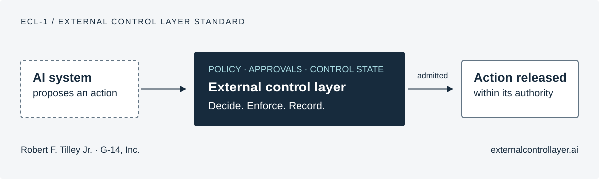

# ECL-1 — External Control Layer Standard

**An open standard for governing AI actions before they take effect.**

ECL-1 specifies how consequential AI actions are authorized, enforced and
recorded. It is for people who build, operate, procure or assess systems that can
change records, move money, send messages or operate equipment.

**Authored and produced by Robert F. Tilley Jr. and G-14, Inc.**

[**Explore ECL-1 → externalcontrollayer.ai**](https://externalcontrollayer.ai/) ·
[**Read the reference book**](https://doi.org/10.5281/zenodo.24092833) ·
[**Get the current release**](https://github.com/G-14-Inc/ECL-1/releases/latest)



An AI system may be able to reach a tool or use a credential. ECL-1 requires a
separate decision about whether the exact action may proceed. For the actions
covered by a mediation claim, an enforcement boundary outside the governed AI's
control applies that decision. Missing required authorization or proof leads
to denial, restriction or halt. Signed records connect the decision to the
request and to what the enforcing component reports.

The standard brings these obligations together with emergency controls,
integration profiles, evidence formats and assessment rules. Each implementation
must establish conformance within its declared actions, boundaries and trust
assumptions. [Read the guarantee and its scope](#the-guarantee).

## Start with what you need

| Your task | Start here |
|---|---|
| Understand the standard | [Website](https://externalcontrollayer.ai/) · [Core specification](standard/ECL-1_Standard.md) |
| Read or cite the complete reference | [Version 1 reference edition — 603 pages](https://doi.org/10.5281/zenodo.24092833) |
| Try one controlled action | [Run the simulated workflow](examples/bounded_workflow/README.md) |
| Check supplied evidence | [Browser verifier](https://externalcontrollayer.ai/verifier) · [Verification quickstart](docs/quickstart.md) |
| Build an integration | [Integration contract](docs/integration-contract.md) · [Implementation guidance](https://externalcontrollayer.ai/implementation) |
| Assess a claim | [Conformance](https://externalcontrollayer.ai/conformance) · [Section 11 checklist](standard/ECL-1_Standard.md#11-conformance-checklist) |
| Examine the design | [Formal models and recorded checks](formal/README.md) · [Reviewer guide](docs/reviewer-guide.md) |

## What is available

**ECL-1 Version 1.0 · Current source release v1.0.1 · Complete Reference Edition, Version 1**

- **628 requirement entries** across the core standard and normative companions.
- **1,011 conformance test vectors**, with expected results and capability scopes.
- **Protocols and integration profiles** for authorization, evidence, MCP, OAuth,
  AuthZEN, AARM, OWASP ACS and OpenTelemetry.
- **Verification tools** in TypeScript, Python, Go and the browser, with their
  supported capabilities documented.
- **TLA+ and Tamarin models**, recorded checks, deliberately broken variants,
  reachability witnesses and stated assumptions.
- **A 603-page reference book**, bringing the specification, guides, model listings
  and indexes together in one citable edition.

The standard and public tools are free under their published licenses. The text
is licensed under [CC BY 4.0](LICENSE-CC-BY-4.0); code and machine-readable
artifacts are under [Apache-2.0](LICENSE). See [LICENSING.md](LICENSING.md) and
the [essential-claims patent pledge](PATENTS.md) for the terms that apply.
Implementing ECL-1 does not require purchasing a G-14 product or service.

## The guarantee

A deployment that conforms to ECL-1 under a full-system or bounded action-class
mediation claim provides this for each consequential action that the claim
declares in scope. The action crosses an enforcement boundary that the governed
AI system cannot bypass, under a decision that the governed AI system cannot
change. A failure that leaves the action without required proof, including an
integrity failure, policy ambiguity or a decision service that does not answer,
ends in denial, restricted mode or halt, and never in the action going ahead.
Each decision leaves tamper-evident evidence that a third party can check and,
from `L2`, verify offline outside the primary control plane.

The guarantee holds only within the boundary, level, independence class and
trust assumptions that a claim states, and only as far as the claim's
assessment establishes it. The opening section of the
[standard](standard/ECL-1_Standard.md), "The ECL-1 Guarantee", lists its seven
elements with the requirements that carry each one, and
[registries/guarantee-trace.json](registries/guarantee-trace.json) traces every
requirement to them. ECL-1 does not judge what an action means, evaluate model
quality or govern an organization; Section 2.10 of the standard says how those
functions connect to a control layer.

## The document set

Every normative document is in Markdown in this repository and, with requirement
anchors, in [static HTML](render/index.html) that needs no script or server.
[release/VERSION_SET.json](release/VERSION_SET.json) binds the designation and
the version of every companion, so that a claim can cite them.

| Document | Version | What it specifies |
|---|---|---|
| [ECL-1 core standard](standard/ECL-1_Standard.md) | 1.0 | Scope and claim boundary, architecture and the runtime control invariant, functional requirements, conformance levels, deployment models and timing, threat model and key custody, and the conformance checklist |
| [DCMP-2](protocols/DCMP-2.md) | 2.0 | Decision and control messages: requests, decisions, authority, challenges and controls |
| [EBMP-2](protocols/EBMP-2.md) | 2.0 | Evidence records, evidence bundles and their offline verification |
| [INTEGRITY-ENVELOPE-1](protocols/INTEGRITY-ENVELOPE-1.md) | 1.0 | The signed envelope of every record, strict JSON, canonical form and resource limits |
| [TIMING-SAFE-STATE-1](protocols/TIMING-SAFE-STATE-1.md) | 1.0 | Timing, availability and safe-state behavior |
| [DISTRIBUTED-WORKFLOW-1](protocols/DISTRIBUTED-WORKFLOW-1.md) | 1.0 | Distributed and long-running workflows |
| [EVIDENCE-LIFECYCLE-1](protocols/EVIDENCE-LIFECYCLE-1.md) | 1.0 | Retention, holds, redaction, export and destruction of evidence |
| [EXTENSION-REGISTRY-1](protocols/EXTENSION-REGISTRY-1.md) | 1.0 | Extensions and registries |
| [TRUST-POLICY-1](profiles/TRUST-POLICY-1.md) | 1.0 | The trust policy that a verifier's caller supplies |
| [DCMP2-HTTP-1](profiles/DCMP2-HTTP-1.md) | 1.0 | The decision exchange over HTTPS |
| [TRANSACTIONAL-EFFECT-1](profiles/TRANSACTIONAL-EFFECT-1.md) | 1.0 | Admission and effect in one store transaction |
| [STRICT-FAILURE-1](profiles/STRICT-FAILURE-1.md) | 1.0 | No fail-open disposition for an in-scope action class |
| [AUTHZEN-BINDING-1](profiles/AUTHZEN-BINDING-1.md) | 1.0 | An AuthZEN policy engine as an additional policy check |
| [AARM-BINDING-1](profiles/AARM-BINDING-1.md) | 1.0 | An AARM control plane as a decision layer or a source of judgment inputs |
| [ACS-BINDING-1](profiles/ACS-BINDING-1.md) | 1.0 | An OWASP Agent Control Standard Guardian and its hooks |
| [MCP-GATEWAY-1](profiles/MCP-GATEWAY-1.md) | 1.0 | An enforcement point in front of MCP servers |
| [OTEL-EVIDENCE-EXPORT-1](profiles/OTEL-EVIDENCE-EXPORT-1.md) | 1.0 | Copies of decisions and evidence in OpenTelemetry log records |
| [OAUTH-AUTHORITY-1](profiles/OAUTH-AUTHORITY-1.md) | 1.0 | One `admit` as one sender-constrained OAuth access token |

Three informative profiles state no requirement of their own:
[CONFORMANCE-CLAIMS-1](profiles/CONFORMANCE-CLAIMS-1.md) (the claim and
assessment documents), [DEPLOYMENT-PROFILES-1](profiles/DEPLOYMENT-PROFILES-1.md)
(the deployment models) and
[OFFLINE-VERIFICATION-1](profiles/OFFLINE-VERIFICATION-1.md) (the offline
package). The machine-readable artifacts are the JSON Schemas in
[schemas/](schemas/) and the registries in [registries/](registries/), among
them the compiled requirements
([registries/requirements-compiled.json](registries/requirements-compiled.json))
and the requirement ledger
([registries/requirement-ledger.json](registries/requirement-ledger.json)).

## Conformance

A conformance claim names the System of Interest it covers and its claim class:
full-system mediation, bounded action-class mediation, or a component or
profile implementation, which does not provide the guarantee (standard,
Section 2.5). It declares one of four levels: `L1` Foundational, `L2` Standard,
`L3` Advanced and `L4` Critical Infrastructure, each including the ones below
it (Section 7.1). It states an independence class, `Class A`, `Class B` or
`Class C`, at least the minimum for its level (Section 7.5), and its status:
full conformance, conditional conformance or assessment-only (Section 7.6). The
public claim statement of Section 7.7 names the version, the level, the status
and the claim boundary; "ECL-1 compliant" on its own is not a claim.

An assessor scores a claim against the conformance checklist of Section 11 of
the standard, with the procedure, pass criteria and fail criteria that
[conformance/requirement-evaluations.json](conformance/requirement-evaluations.json)
gives for every requirement. [docs/l1-minimum.md](docs/l1-minimum.md) lists
every requirement and checklist item that an `L1` claim answers.

A conformance claim is self-declared. An implementer publishes its claim with
its conformance report, the results of the conformance tests and the offline
verifier's output on its evidence, by pull request to the implementers registry
of this repository ([community/implementers.yaml](community/implementers.yaml)), as
[governance/CONFORMANCE_CLAIMS.md](governance/CONFORMANCE_CLAIMS.md) describes. The
editors check that the submission is complete and list it as self-declared; an
assessor's assessment is listed separately when the implementer provides it.
G-14 certifies nothing. "ECL-1" may be used descriptively
([marks](governance/TRADEMARKS_AND_MARKS.md)).

## The conformance tests

[conformance/](conformance/README.md) holds the conformance tests with their
expected results: positive and negative vectors in
[conformance/manifest.json](conformance/manifest.json) and in the suites of
`conformance/suites/`, and
[conformance/shared-corpus.json](conformance/shared-corpus.json), which names
every vector and the capability it needs. Its README states, for each stage,
the input, the steps in order and the findings that an implementation reports,
and every measured unit of the coverage denominator
([conformance/coverage-denominator.json](conformance/coverage-denominator.json))
has a passing and a failing vector. Sample evidence, signed bundles with the
trust policy that verifies them, is in `conformance/fixtures/evidence/`. A run
of the tests is recorded in a report following the conformance report template
[conformance/report-template-v3.json](conformance/report-template-v3.json).
[conformance/scenarios/](conformance/scenarios/README.md) holds ten incident
scenarios from the Control Gap Record, each with the outcome every step must
have.

## Formal specification and model checking

ECL-1 includes a machine-checkable TLA+ specification of its core runtime
control design. It makes the rules for authorization, enforcement, revocation,
timeouts, emergency halt and evidence recording precise enough for another
engineer to inspect and check mechanically. The TLC model checker explores the
reachable states and permitted interleavings of the documented finite
configurations, checking both safety properties and, under stated fairness
assumptions, liveness properties.

The assurance package includes the correct design, deliberately broken
variants that must expose the consequences of removing a rule, and
reachability witnesses that demonstrate that important situations can occur.
The checked-in record contains **32 TLC checks: three correct configurations,
22 broken variants and seven witnesses**. Each has its expected outcome.
These are results about the modeled design under its stated assumptions and
bounds. Implementation conformance, operational qualification and a
deployment's conformance claim require their own evidence.

### Files, terminology and the scope of the claim

| Artifact | Purpose |
|---|---|
| [formal/tla/ECLCore.tla](formal/tla/ECLCore.tla) | The state variables, transitions, safety and liveness properties, and deliberately selectable flaws |
| [formal/tla/MC.tla](formal/tla/MC.tla) | Concrete model values, the allowed action, symmetry reduction and reachability assertions |
| [formal/tla/configs/](formal/tla/configs/) | The exact constants and properties checked by each of the 32 TLC configurations |
| [formal/run_checks.py](formal/run_checks.py) | Tool pins, expected outcomes, execution commands and result recording |
| [formal/results.json](formal/results.json) | Machine-readable outcomes, input SHA-256 digests, settings, state counts and tool information |
| [formal/README.md](formal/README.md) | Requirement mappings, abstractions, reproduction instructions and the complete result tables |
| [formal/protocol/DCMP2_Binding.spthy](formal/protocol/DCMP2_Binding.spthy) | The separate Tamarin model of signed DCMP-2 messages and their binding |

**TLA+ is the specification language; TLC is the explicit-state model checker.**
TLAPS is a separate system for checking deductive proofs. This package uses
TLC to check selected finite configurations. The distinctions are described by the
[TLA+ tools documentation](https://lamport.azurewebsites.net/tla/tools.html).
TLC runs as an engineering check of the model; it is not an authorization
service invoked before each deployed action. The deployed control layer must
perform its own checks before an action takes effect.

### The system represented in TLA+

The model represents the following participants and state.

- **The governed AI system, or actor,** can submit requests through any
  enforcement point. It chooses its own `actor_supplied` self-report and can
  steer a `judgment` risk-score input. It can present any request identifier,
  target and parameters with any issued authority object at any enforcement
  point, including replay and attempted reuse after expiry, revocation or
  halt. In the correct design it cannot create decisions or authority, edit
  evidence, or reach an effect around enforcement.
- **The decision service** returns `admit`, `deny`, `hold` or `challenge` under
  policy and trust state. Only an `admit` issues authority. Reuse of a request
  identifier with different request content is denied when the earlier
  request has a recorded decision. A request closed by timeout without a
  decision is outside that collision history. An authenticated
  approval or signed witness can resolve a hold or challenge through a new
  decision based on verifiable inputs; that resolution is not a step the actor
  can perform. Decision-service failure and recovery are explicit transitions.
- **An authority object** binds the request identifier and action, the audience
  enforcement point, a validity interval, a trust epoch and single-use
  consumption. The action consists of a target and parameters. The model
  represents its scope digest by the exact structured value, without modeling
  a hash algorithm or collisions.
- **Enforcement points** check presented authority before producing effects.
  Each has a local view of revocations, trust epoch and the time of its last
  control-state refresh. The model tracks authority already consumed and
  requests closed by denial or the declared safe state.
- **The control plane** can revoke authority and advance a policy/trust epoch.
  Enforcement points refresh their local views while the modeled control
  service is reachable. An epoch change ends authority from earlier epochs as
  the change propagates; local enforcement and propagation bounds matter.
- **The emergency plane** can request a halt, and each enforcement point can
  acknowledge it. Its halt and acknowledgment steps do not require the
  decision service to be available. The actor cannot invoke this separately
  authenticated plane in the correct model.
- **Effects and evidence** are separate modeled collections, but the correct
  execution step creates the effect and appends its evidence record together.
  A broken variant separates those steps. The modeled log contains effect
  identifiers; it is not a representation of every field of a real signed
  evidence bundle.
- **Time** is one global discrete counter. Requests and holds have deadlines;
  authority has a validity window; control-state freshness, propagation and
  halt acknowledgment have declared bounds. Ticks are abstract units, not
  measured milliseconds or a model of an operating system's wall clock.

The initial state has the service available, empty requests, decisions,
authority, effects and evidence, epoch zero, fresh initial enforcement-point
views and no halt. From there, TLC explores the possible orderings of request
submission, decision, authenticated resolution, timeout, execution, refresh,
revocation, trust change, outage, recovery, halt and time advancement that the
configuration permits. The flaw-only transitions additionally allow bypass,
forged authority or decisions, evidence erasure, or other named rule removals.

### How an effect is admitted in the model

The correct `Execute` transition requires an authority object actually present
in the issued set and the checks defined by `Admissible`:

1. The presented request identifier matches the authority's request identifier.
2. The target and parameters match the authority's action.
3. The executing enforcement point is the authority's audience.
4. Time is in the half-open validity interval: `from <= now < until`.
5. The authority has not already been consumed.
6. The executing enforcement point's local revocation view does not revoke
   the authority, and the authority's epoch is acceptable against that
   enforcement point's refreshed epoch.
7. The enforcement point's control state is within its staleness bound.
8. The enforcement point has not acknowledged a halt.

In that atomic modeled transition, authority is consumed, the effect is added
and the evidence record is appended. `SingleUse` is a property of an authority
object: it must not be read as a proof of every real application's distributed
idempotency or exactly-once delivery.

### Every checked safety property

Safety describes what must never go wrong. The three correct configurations
each check **12 state invariants and five action properties**. An invariant
constrains each reachable state; an action property constrains transitions,
including how an effect relates to the control state immediately before it.
The requirement mappings for every property are in
[formal/README.md](formal/README.md#properties).

| Property | Kind | What the check establishes within the configuration |
|---|---|---|
| `TypeOK` | State invariant | Time, requests, decisions, authority, control views, effects and the log stay within their declared modeled types. |
| `EffectHasMatchingAdmit` | State invariant | Every effect has an authority object derived from an actual `admit`, for the same request identifier, target and parameters, with the executing enforcement point as audience. |
| `EffectWithinAuthority` | State invariant | An effect stays within its authority's scope, audience and validity interval. |
| `SingleUse` | State invariant | Two different effects cannot consume the same authority object. |
| `NoEffectBeyondHaltBound` | State invariant | No effect occurs later than the declared bound `B` after a halt request. This is a bound in modeled ticks, not a measured deployment latency. |
| `RevocationBound` | State invariant | After revocation or an epoch change, effects stop within the propagation bound when the service has remained reachable since the change, and within the larger of the propagation and staleness bounds in any case. |
| `EffectHasEvidence` | State invariant | Every modeled effect has its corresponding modeled evidence record. |
| `OneWayRule` | State invariant | Every decision is at least as restrictive as the policy outcome supported by verifiable inputs alone. Actor-influenced self-reports and judgment cannot turn a verifiable denial into admission. |
| `AdmitOnlyAllowed` | State invariant | Every `admit` concerns an action in the set supported by the model's verifiable inputs. |
| `NoEffectDuringOutage` | State invariant | An effect during a service outage uses authority issued before the outage and remains inside the staleness bound counted from the start of the outage; the other authority checks still apply. The name does not mean that all effects during every outage are prohibited. |
| `SafeStateHasNoEffect` | State invariant | A request that ended in denial or the declared safe state has no effect. A late decision must not revive that closed request. |
| `DeadlineBound` | State invariant | Model time cannot pass an unresolved decision or hold deadline; the constraint is encoded in `Tick`. |
| `NoLateDecision` | Action property | A new decision for a pending or held request precedes its deadline, using the model's conservative exclusive boundary. |
| `NoEffectAtHaltedEP` | Action property | Once an enforcement point acknowledges a halt, it produces no new effect. |
| `NoEffectWithKnownRevocation` | Action property | An enforcement point produces no new effect using authority it already knows is revoked or from an ended epoch. |
| `LogAppendOnly` | Action property | Existing evidence records are retained unchanged and in order; transitions cannot erase or rewrite the log's existing prefix. |
| `DecisionsAppendOnly` | Action property | Existing decision and issued-authority records remain in their sets; revocation is represented separately rather than by deleting or rewriting issued records. |

The one-way rule uses the standard's strictness order,
`admit < challenge < hold < deny`. The verifiable-only policy in this model
returns only `admit` or `deny`; actor-influenced inputs may tighten that
outcome. The model does not compare different scopes of authority granted by
two `admit` decisions, or model the full data-provenance and completeness
checks of ECL1N-0178 to ECL1N-0182.

### Liveness, deadlines and fairness

Safety alone could hold in a system that never completes useful work. The
`correct-liveness` configuration also checks three temporal properties.

| Property | What eventually happens |
|---|---|
| `HoldResolves` | A held or challenged request receives a final `admit` or `deny`, or ends in the declared safe state. |
| `RequestResolves` | Every submitted request receives a final `admit` or `deny`, or ends in the declared safe state. |
| `HaltTakesEffect` | Once a halt is requested, every modeled enforcement point eventually acknowledges it. |

These results assume **weak fairness** for time advancement, control-state
refresh, halt acknowledgment and decision/hold timeouts: an owed step that
remains enabled cannot be postponed forever. There is no fairness assumption
requiring the actor to submit work, an operator to approve it or request a
halt, or the environment to restore the failed service. A timeout can satisfy
resolution through safe closure; liveness does not promise that each request
will be approved or that an admitted request will actually execute.

Time advances only while the model's connected-propagation, halt-acknowledgment
and pending-request/hold deadline obligations are respected. It can reach an
unresolved deadline but cannot pass it until the request is resolved. Decisions
require `now < deadline`; this exclusive boundary is a conservative model
choice, while TS1-009 says a gate that "exceeds" its deadline enters the safe
state. Deadlines are clamped to `MaxTime`; a request submitted at that horizon
or with a zero decision deadline permits only timeout resolution. Those transition guards encode
the timing contract being analyzed. TLC does not demonstrate that real
hardware, networks, scheduling or operators can meet its bounds. That requires
implementation and deployment measurements, including release-boundary clock
checks. All 32 TLC configurations set `CHECK_DEADLOCK FALSE`, disabling
deadlock checking. The modeled clock stops at `MaxTime`.

### The finite configurations and what they cover

The three correct configurations vary different aspects of the same model.
Every listed count and tick limit is a model-checking bound, not a recommended
deployment limit.

| Constant or behavior | [correct-binding](formal/tla/configs/correct-binding.cfg) | [correct-control](formal/tla/configs/correct-control.cfg) | [correct-liveness](formal/tla/configs/correct-liveness.cfg) |
|---|---|---|---|
| Enforcement points | 2 | 2 | 1 |
| Request identifiers | 2 | 1 | 1 |
| Targets × parameter values | 2 × 2: four actions, one allowed | 1 × 1: one allowed action | 1 × 2: two actions, one allowed |
| Maximum submitted requests | 3 | 1 | 2 |
| Explored time values | 0–3 | 0–4 | 0–3 |
| Maximum decision-service outages | 0 | 1 | 1 |
| Maximum explicit revocations | 0 | 1 | 0 |
| Maximum trust-epoch changes | 0 | 1 | 0 |
| Emergency halt permitted | No | Yes | Yes |
| Authority validity | 2 ticks | 4 ticks | 2 ticks |
| Decision and hold deadlines | 1 tick each | 1 tick each | 1 tick each |
| Propagation bound | 3 ticks | 1 tick | 1 tick |
| Staleness bound | 3 ticks | 2 ticks | 1 tick |
| Halt acknowledgment bound `B` | 1 tick; no halt in this configuration | 1 tick | 1 tick |
| Refresh without new control information | Omitted as redundant under these bounds | Permitted | Permitted |
| Symmetry reduction | Enforcement points and request identifiers | Enforcement points and request identifiers | None |
| Properties checked | All 17 safety properties | All 17 safety properties | All 17 safety properties plus three liveness properties |

The binding configuration exercises changed targets, parameters, request
identifiers and audiences. The control configuration exercises failure,
recovery, revocation, trust change and halt. The liveness configuration checks
resolution and halt acknowledgment under fairness. Some properties hold
trivially in configurations that disable their triggering behavior:
`correct-binding` permits no outages, revocations, trust changes or halt;
`correct-control` contains only the allowed action; and `correct-liveness`
permits neither revocation nor trust change. The witnesses below establish
their named situations within their own bounds. Symmetry reduction treats
interchangeable enforcement-point and request-identifier names alike; it is
disabled for liveness because it can hide a liveness violation. A result for
these configurations is not an inductive proof for an arbitrary fleet size,
number of requests or time horizon.

### Deliberately broken designs: every negative TLC check

Each variant removes or alters a named rule. The runner requires TLC to find a violation
of the particular property listed below. A counterexample is therefore the
**expected successful outcome of the negative test**, not a passing result for
the defective design. These variants demonstrate the significance of the
modeled rules; they do not mean that 22 corresponding vulnerabilities were
found in a deployed implementation.

| Configuration | Rule removed or defect introduced | Required counterexample |
|---|---|---|
| [broken-outage-proceeds](formal/tla/configs/broken-outage-proceeds.cfg) | An outage lets an action proceed without required authority. | `NoEffectDuringOutage` |
| [broken-late-decision-used](formal/tla/configs/broken-late-decision-used.cfg) | A decision received after safe closure can release the request. | `SafeStateHasNoEffect` |
| [broken-no-digest-binding](formal/tla/configs/broken-no-digest-binding.cfg) | Presented parameters need not match authority. | `EffectHasMatchingAdmit` |
| [broken-no-target-binding](formal/tla/configs/broken-no-target-binding.cfg) | The target need not match authority. | `EffectHasMatchingAdmit` |
| [broken-no-audience-binding](formal/tla/configs/broken-no-audience-binding.cfg) | An authority's audience is not enforced. | `EffectWithinAuthority` |
| [broken-no-window](formal/tla/configs/broken-no-window.cfg) | Authority validity is not checked. | `EffectWithinAuthority` |
| [broken-no-single-use](formal/tla/configs/broken-no-single-use.cfg) | Previously consumed authority can be used again. | `SingleUse` |
| [broken-ignore-revocation](formal/tla/configs/broken-ignore-revocation.cfg) | Known revocation and epoch changes are ignored. | `NoEffectWithKnownRevocation` |
| [broken-ignore-staleness](formal/tla/configs/broken-ignore-staleness.cfg) | An enforcement point continues with stale control state. | `NoEffectDuringOutage` |
| [broken-no-propagation-deadline](formal/tla/configs/broken-no-propagation-deadline.cfg) | Control-state propagation has no enforced deadline. | `RevocationBound` |
| [broken-ignore-halt](formal/tla/configs/broken-ignore-halt.cfg) | An acknowledged halt does not prevent execution. | `NoEffectAtHaltedEP` |
| [broken-halt-unbounded](formal/tla/configs/broken-halt-unbounded.cfg) | Halt acknowledgment has no enforced bound. | `NoEffectBeyondHaltBound` |
| [broken-evidence-not-atomic](formal/tla/configs/broken-evidence-not-atomic.cfg) | An effect can happen before its evidence is recorded. | `EffectHasEvidence` |
| [broken-bypass](formal/tla/configs/broken-bypass.cfg) | The actor has a path around enforcement. | `EffectHasMatchingAdmit` |
| [broken-actor-writes-authority](formal/tla/configs/broken-actor-writes-authority.cfg) | The actor can create authority. | `EffectHasMatchingAdmit` |
| [broken-actor-writes-decision](formal/tla/configs/broken-actor-writes-decision.cfg) | The actor can record its own admission. | `AdmitOnlyAllowed` |
| [broken-actor-erases-evidence](formal/tla/configs/broken-actor-erases-evidence.cfg) | The actor can remove existing evidence. | `LogAppendOnly` |
| [broken-judgment-admits](formal/tla/configs/broken-judgment-admits.cfg) | A favorable risk score can admit without verifiable support. | `OneWayRule` |
| [broken-self-report-admits](formal/tla/configs/broken-self-report-admits.cfg) | A favorable actor self-report can admit without verifiable support. | `OneWayRule` |
| [broken-hold-never-times-out](formal/tla/configs/broken-hold-never-times-out.cfg) | A hold has no timeout path. | `HoldResolves` |
| [broken-no-decision-timeout](formal/tla/configs/broken-no-decision-timeout.cfg) | A request can wait indefinitely for a decision. | `RequestResolves` |
| [broken-halt-ack-lost](formal/tla/configs/broken-halt-ack-lost.cfg) | Enforcement points do not acknowledge a requested halt. | `HaltTakesEffect` |

### Reachability witnesses: useful work and permitted windows

A safety property can hold because the situation it discusses never occurs.
The seven witness configurations run the correct design and ask TLC to violate
an assertion that a particular situation never happens. The resulting trace
establishes that the situation is reachable within that configuration. In
these checks, a counterexample is an existence witness, not a defect report.

| Configuration | What the expected witness establishes |
|---|---|
| [witness-effect](formal/tla/configs/witness-effect.cfg) | An authorized effect can actually occur. |
| [witness-admit-after-hold](formal/tla/configs/witness-admit-after-hold.cfg) | A held request can receive an authenticated resolution and then an `admit`. |
| [witness-collision-deny](formal/tla/configs/witness-collision-deny.cfg) | Reusing a request identifier for different content can produce a denial. |
| [witness-effect-during-outage](formal/tla/configs/witness-effect-during-outage.cfg) | An earlier admission can permit an effect during an outage while the other controls and staleness bound still permit it. |
| [witness-effect-in-revocation-window](formal/tla/configs/witness-effect-in-revocation-window.cfg) | Authority can be exercised after revocation or trust change but before the enforcement point learns of it, inside the permitted propagation window. |
| [witness-effect-in-halt-window](formal/tla/configs/witness-effect-in-halt-window.cfg) | An effect can occur after a halt request and before its acknowledgment, inside the permitted halt window. |
| [witness-timeout](formal/tla/configs/witness-timeout.cfg) | A request can reach its safe state without receiving any decision. |

In particular, the outage, revocation and halt witnesses expose the residual
windows that the design deliberately bounds. The results do not establish
instantaneous revocation, an instantaneous global stop or zero effects during
every outage. A deployment chooses its bounds and demonstrates that its actual
enforcement and timing meet the declared contract.

### Recorded results and how to reproduce them

The checked-in [results record](formal/results.json) reports these positive
TLC runs of November 7, 2026 on the repaired model. The original release record
remains in the original release archive. State counts describe separately
explored state graphs; their sum would not count unique system states. Durations describe the recorded machine,
not a deployment performance guarantee.

| Correct configuration | Distinct states | States generated | Search depth | Recorded seconds | Outcome |
|---|---:|---:|---:|---:|---|
| `correct-binding` | 453,291 | 1,081,821 | 14 | 13.9 | No error found |
| `correct-control` | 4,606,888 | 17,564,984 | 24 | 104.4 | No error found |
| `correct-liveness` | 58,148 | 136,618 | 17 | 9.2 | No error found |

The record also reports the required counterexample for each of the 22 broken
variants and seven witnesses. Its `passed` field means that the observed
outcome matches that check's expectation. A timeout, tool failure or missing
expected counterexample does not count as successful verification. Liveness
counterexample sizes can vary with the timing of TLC's temporal checks; the
required violated property remains the same.

The runner pins **TLC 1.7.4** and verifies the `tla2tools.jar` SHA-256
`936a262061c914694dfd669a543be24573c45d5aa0ff20a8b96b23d01e050e88`.
It runs TLC with one worker and a 1,500 MB Java heap. The per-check time limit
is controlled by `--timeout` (in seconds), which defaults to `900`.
The runner records the actual Java runtime per check and imposes no Java 21
gate. The new TLC checks used Java `17.0.20.1`; the original record also named
that version in its shared field but lacked per-check runtime metadata.
New v2 records retain per-check input and output hashes, commands and timestamps;
complete captured outputs are in `formal/evidence/`. Pinned Tamarin and Maude
downloads and their digests are listed in
[the reproduction guide](formal/README.md#running-the-checks).

From the repository root, with Python 3.10 or later and the pinned TLC JAR:

```sh
# Run all 32 TLC configurations, including failures and witnesses.
python3 formal/run_checks.py --skip-tamarin \
  --tla2tools /path/to/tla2tools.jar

# Run one correct configuration for inspection; this is only a partial run.
python3 formal/run_checks.py --only correct-control \
  --tla2tools /path/to/tla2tools.jar

# Retain a separate TLC result record outside the source tree.
python3 formal/run_checks.py --skip-tamarin \
  --tla2tools /path/to/tla2tools.jar \
  --record /path/to/evidence/tlc-results.json
```

With the pinned Tamarin and Maude tools also available, run the complete
formal suite and retain its record outside the source tree:

```sh
python3 formal/run_checks.py \
  --tla2tools /path/to/tla2tools.jar \
  --tamarin /path/to/tamarin-prover \
  --maude-dir /path/to/maude-directory \
  --record /path/to/evidence/formal-results.json
```

`ECL_TLA2TOOLS_JAR`, `ECL_TAMARIN_PROVER` and `ECL_MAUDE_DIR` provide the same
tool locations. A missing tool causes refusal. Mismatched pins cause refusal
unless the explicit exploratory `--allow-unpinned` option is selected. A run with
mismatched pins cannot produce a recorded result, even with that override.
A TLC-only or single-configuration run is not the
complete formal suite. `--readme` only regenerates the detailed guide's result
tables from the existing record; it does not run a checker.

Every check's recorded `inputs` field binds the model files and, for TLC, the exact
configuration by SHA-256. `--record` can preserve checks not selected in that
invocation, so the presence of a combined file alone does not show that all
checks ran in the current invocation. Inspect its coverage, input digests,
tool/settings metadata and the execution logs. The maintainer's tests check
that committed results match the model inputs, cover the expected checks and
agree with the result tables. Changed models require corresponding fresh
evidence; unchanged model inputs do not make an entire changed release
candidate qualified.

### The separate Tamarin contribution

TLA+ abstracts signatures and hashes. The complementary
[Tamarin protocol model](formal/protocol/DCMP2_Binding.spthy) analyzes signed
DCMP-2 request/response binding with perfect symbolic cryptography, a network
adversary and explicit key-reveal possibilities. Its seven named lemmas cover
an executable honest flow, request origin, response authenticity,
request/response binding, authorization scope and audience, single use and one
effect per request. Authentication claims have their documented key-reveal
qualifications; the honest-flow lemma is an existence check.

The formal suite has nine Tamarin checks: one correct protocol checking all
seven lemmas, plus eight deliberately flawed protocol variants, each required
to falsify its named lemma. Those results are distinct from the 32 TLC checks.
They do not establish the security of an implementation's cryptographic
library, real key custody, encoding, side channels, clock or durable use store.
The [protocol-model documentation](formal/README.md#the-protocol-model)
states the assumptions and every lemma and flaw.

### What the models leave to implementations and assessments

The models give a checkable control design. The connection to executable code
still has to be established by implementation, testing, inspection and
deployment evidence. In particular:

- **Mediation and separation are modeled boundaries.** The correct design
  gives the actor no bypass or write access to control records; the broken
  variants show the consequences of removing that separation. The models do
  not discover every credential, network path, administrative capability or
  alternate tool route in a real deployment.
- **Cryptographic detail is abstracted.** TLA+ uses exact structured values
  rather than cryptographic digests, and its append-only sequence is not a
  signed hash chain. Tamarin uses ideal signatures and hashes. Neither checks
  implementation-level encoding attacks, weak keys or side channels.
- **Policy is simplified.** A fixed set of allowed actions stands for the
  policy over verifiable inputs. Policy ambiguity, pre-release obligations,
  consequence budgets, the complete decision-input provenance procedure and
  comparisons between differently scoped admissions are outside this TLA+
  model. A trust-epoch transition is not a model of human control-change
  review, organizational governance or the correctness of the chosen policy.
- **There is one decision service and one global discrete clock.** Independent
  clocks, skew, backward or forward wall-clock steps, oscillator drift,
  process scheduling delays, large fleets and arbitrary distributed
  partitions are not checked by these configurations. Clock behavior must be
  checked on the actual implementation and qualification host.
- **Model steps are atomic and consume no time internally.** Real code may
  release a call after its last check, while authorization or required proof
  expires in between. The real enforcement point must establish validity at
  the release/effect boundary using the timing mechanisms the standard permits
  (ECL1N-0186, ECL1N-0188); the TLA+ transition does not prove that it does so.
- **Evidence and effect occur together in the correct model.** A remote send,
  durable journal and eventual response usually require several real steps.
  Durable pre-release recovery information and classification of uncertain
  outcomes remain implementation obligations, as specified by ECL1N-0189 and
  the applicable profile. A signature alone does not establish atomicity.
- **Model consumption is not a durable distributed-use implementation.** The
  model consumes authority together with its effect. Real implementations
  must preserve single-use behavior across concurrent instances, retries and
  recovery, including a use that remains spent after a later check refuses.
  The models do not prove an application's exactly-once remote effect.
- **Process crashes and storage loss are not transitions.** Service outage and
  recovery are modeled availability changes, not arbitrary process or storage
  failure. Failed sends, lost replies, interrupted recovery, durability and
  repeated recovery need the separate failure model and evidence of the
  implementation's claim (ECL1N-0189, ECL1N-0190).
- **Several specification areas have no representation here.** These include
  delegation chains, distributed workflows, offline evidence-bundle verdicts,
  release-observation and pre-release-discharge bundle checks, historical
  trust-policy versions, trusted-time countersignatures and extension
  handling. Their normative requirements and conformance vectors remain
  applicable even though the TLA+ model does not cover them.
- **Assumptions are not deployment measurements.** Propagation, staleness and
  halt bounds, trusted verifiable sources and separately authenticated control
  are part of the model's contract. A larger configuration or a real system
  that violates those assumptions can fail despite these model-checking
  results.

[From the models to an implementation](formal/README.md#from-the-models-to-an-implementation)
maps these abstraction boundaries to the relevant requirements. The formal
artifacts help a reviewer ask whether the implemented enforcement preserves
the modeled rules, which assumptions the deployment actually meets and what
separate evidence supports the remaining claims.

## The offline verifier

The offline verifier checks a signed evidence bundle, or an offline package
that carries one, under a trust policy that you choose, with no account and no
network request.

- In a browser, open [web/verifier/index.html](web/verifier/index.html) from
  disk ([how it works](web/verifier/README.md)).
- On the command line, use `ecl-verify-ts` from the TypeScript package
  [packages/ecl-ts](packages/ecl-ts/README.md), with Node.js 22:

```sh
cd packages/ecl-ts
npm ci
npm run build
node dist/cli/ecl-verify.js ../../conformance/fixtures/evidence/succeeded.json \
  --trust-policy ../../conformance/fixtures/evidence/trust-policy.json
```

Python (`ecl-verify`) and Go (`ecl-verify-go`) command-line verifiers are also
published in [packages/ecl-verify](packages/ecl-verify/README.md) and
[go/crosscheck](go/crosscheck/README.md). The [quickstart](docs/quickstart.md)
runs all three and the shared corpus from this release alone.

The `ecl-verify-ts` command prints the verdict (`verified`, `invalid`, `incomplete` or
`current-trust-failed`), what the verdict establishes and what it does not, and
it exits with 0 for a verified bundle. Its `--json` option prints the report as
JSON. The TypeScript package's unit and browser tests ship with that package (`npm test`,
`npm run test:browser`), and `node scripts/check-corpus.mjs` runs
`ecl-verify-ts` on every bundle and package vector of the conformance tests and
compares each verdict with the expected one.

## Guides

The guides are informative; where a guide and a requirement differ, the
requirement governs.

- [Buyer summary](docs/buyer-summary.md): ECL-1 in one page, what a claim must
  say and what to ask a supplier for.
- [Implementer guide](docs/implementer-guide.md): what to implement, how to run
  the conformance tests and how to report the run.
- [Assessor guide](docs/reviewer-guide.md): how to check a claim and its
  evidence with this package, and how to report findings
  ([findings template](docs/review-findings-template.md)).
- [Agent and tool integration contract](docs/integration-contract.md): what an
  agent host, a tool server, a gateway or a policy engine must expose to a
  control layer, and must not hold.
- [Bindings guide](docs/bindings.md) and [AuthZEN guide](docs/authzen-binding.md):
  how ECL-1 works with AARM, ACS, MCP, OpenTelemetry, OAuth and AuthZEN.
- [Keeping fail-closed control available](docs/availability.md): redundancy,
  scoped restricted mode and degraded modes within the rules.
- [Threat model](docs/threat-model.md): the threats that the protocols and
  profiles address, and what remains.
- [Crosswalks](docs/crosswalk.md) to AARM and the OWASP Agent Control Standard,
  and [control-gap coverage](docs/gap-coverage.md) of the 13 gaps of the
  Control Gap Classification.

## Taking part

G-14, Inc. and Robert F. Tilley Jr. provide the interim editorial and contact
function while the community working group is being formed. ECL-1 is open to
community participation and stewardship under the charter. Community roles,
working-session dates and agendas will be announced publicly as they are
established; no outside appointment or completed meeting is implied.
Contact ecl@g14.ai to participate.

The charter provides for open development through the ECL-1 Working Group.
Anyone may join, at no cost, by signing up through this repository, as
[community/WORKING_GROUP.md](community/WORKING_GROUP.md) describes. Working
sessions and public notes will follow the charter's procedures once sessions
are established and announced. The [charter](governance/CHARTER.md) sets out how it works: the editors
propose, the working group discusses, and the editors decide by rough consensus
and record the reason. [governance/](governance/README.md) holds the change,
errata, registry, release and appeals procedures.

- Comment, ask or propose in this repository's issues, discussions and pull
  requests. Every commit carries a Developer Certificate of Origin sign-off
  ([governance/DCO.txt](governance/DCO.txt), [contributing](governance/CONTRIBUTING.md)).
- Each new minor version has a public review window of 30 days, and each new
  major version one of 60 days, announced on externalcontrollayer.ai. Every
  comment receives a published disposition ([governance/PUBLIC_REVIEW.md](governance/PUBLIC_REVIEW.md)).
- Report an error in a published text as an issue
  ([errata](governance/ERRATA.md)).
- Report a security problem privately, never in a public issue
  ([SECURITY.md](SECURITY.md)).

The working group's contact address is ecl@g14.ai.

## Rights

The specification text and documentation are licensed under Creative Commons
Attribution 4.0 International, CC BY 4.0 ([LICENSE-CC-BY-4.0](LICENSE-CC-BY-4.0)). The machine-readable
artifacts and the code, among them the schemas, registries, conformance tests,
sample evidence and the offline verifier, are licensed under the Apache License,
Version 2.0 ([LICENSE](LICENSE)). [LICENSING.md](LICENSING.md) says which license applies to which
files. G-14, Inc. pledges, royalty-free, not to assert its essential patent
claims against implementations of ECL-1 Version 1.0 and its companion
specifications, on the terms of [PATENTS.md](PATENTS.md). G-14 has patents pending. Third-party material keeps its own
license and notices ([licenses/THIRD_PARTY_NOTICES.md](licenses/THIRD_PARTY_NOTICES.md)).

## Maintainer

ECL-1 is maintained by G-14, Inc., which hosts this repository, provides the
editors and the chair of the working group, runs public review, and publishes
releases and errata. G-14 is developing a commercial implementation of ECL-1. Nothing in the
standard depends on it, and an implementation's conformance claim, G-14's
included, is self-declared under the same rules as any other.

## Release identity and verification

The [v1.0.1 release](https://github.com/G-14-Inc/ECL-1/releases/tag/v1.0.1)
contains `ecl-1-1.0.1.zip`, `ecl-1-1.0.1-manifest.json`,
`ecl-verify.cdx.json`, `ecl-ts.cdx.json` and `SHA256SUMS`, together with the
Version 1 reference PDF, font notices and correction record. The archive contains
the public specification, supporting documents, formal models, conformance
corpus, verifiers and teaching workflow. The two CycloneDX SBOMs describe the
Python and TypeScript verifiers' exact public dependency locks.

`SHA256SUMS` covers every supplied release asset other than itself. Download
them into one directory, then check:

```sh
sha256sum --check --strict SHA256SUMS
```

On Windows, `Get-FileHash -Algorithm SHA256 <filename>` computes a file's
digest for comparison with `SHA256SUMS`. The manifest also lists every archive
member's size and SHA-256. G-14, Inc. supplies no separate maintainer
signature for this release. Hashes establish file integrity;
any hosting-service attestation has its own identity and verification scope.
The [original v1.0 release](https://github.com/G-14-Inc/ECL-1/releases/tag/v1.0)
and its five assets remain available under their original names and digests.

The [release notes](RELEASE-NOTES-1.0.md#review-status) disclose the review
status and the maintainer's
[correction-release exception](governance/RELEASE_POLICY.md#correction-release-exception-v101).
The [formal specification and model-checking description](#formal-specification-and-model-checking)
explains all 32 TLC configurations and the nine separate Tamarin checks,
including their assumptions, expected counterexamples, reproduction commands
and limits. These results apply to the modeled design; implementation and
deployment conformance require their own evidence.
